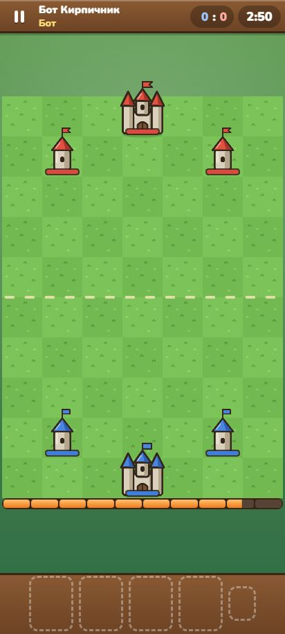
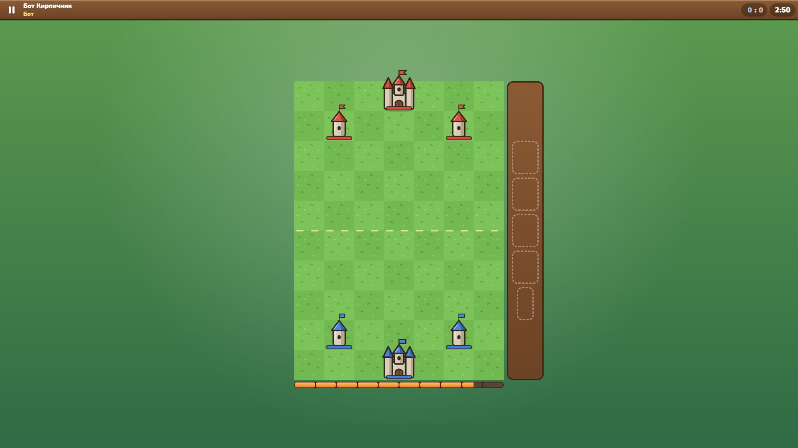
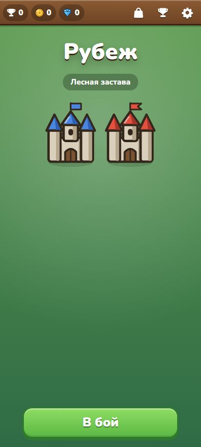
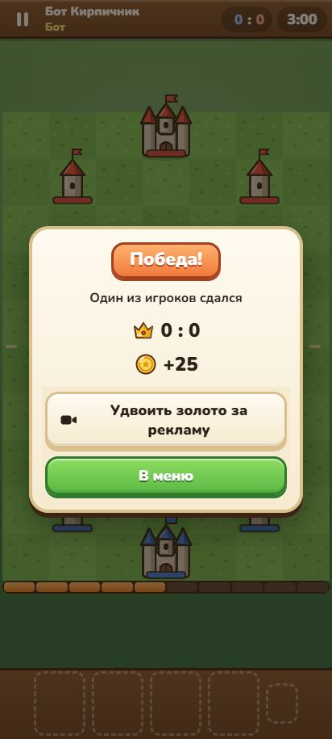

<div align="center">

# Рубеж · Frontline Forts

**Соревновательная дуэль фортов для Яндекс Игр.**
Ставь постройки на клетки, двигай рубеж к врагу, накладывай карты в звёзды и снеси вражескую крепость за три минуты.


</div>

<table>
<tr>
<td width="290" valign="top"></td>
<td valign="top">

### Что в игре

- **Бой 1 на 1 на поле 7×10.** У каждого — крепость и две башни. Карты-постройки стреляют сами по ближайшему врагу; урон в тике считается одновременно.
- **Рубеж.** Строить можно только в своей зоне: два задних ряда и клетки рядом со своими постройками. Каждая постройка двигает фронт вперёд, потерял передовую — рубеж откатился.
- **Наложение.** Та же карта на свою постройку даёт звезду (до трёх): +50% прочности и урона, полное восстановление.
- **16 карт.** Стены, вышки, лучники, пушки, мортиры, баллисты, катапульты, ледяная башня, знамя, купол, лекарь, мастерская, аванпост и заклинания — огненный шар, ремонт, землетрясение.
- **Соперники — записи боёв других игроков** через асинхронный мультиплеер Яндекса; пока записей мало — боты. В бою всегда видно, с кем играешь.
- **Мета:** пять арен, кубки, сундуки с таймерами, прокачка карт, три колоды, задания дня, магазин карт, рейтинг.

</td>
</tr>
</table>

> Графика на скриншотах — временная, из Этапа 0. Финальный стиль — суровое «подростковое» средневековье: тёмный камень, железо, огонь, угловатые силуэты ([`docs/art-style.md`](docs/art-style.md)).

## Скриншоты

<p align="center">
  
</p>
<p align="center">
  
  
</p>

## Дорожная карта

Проект идёт по этапам ТЗ. У каждого этапа есть контрольные точки, которые проверяются тестами, командами или плейтестом ([`docs/PLAN.md`](docs/PLAN.md)). Этап закрыт, когда `npm run verify` зелёный.

| | Этап | Что входит | Статус |
|---|---|---|---|
| 0 | **Каркас и пробник мультиплеера** | Проект на шаблоне StarterPackYG: слой платформы, пауза и звук, реклама по правилам, облачные сохранения, сборка и проверка архива, e2e в трёх браузерах. Поле 7×10 с крепостями. Пробник асинхронного мультиплеера для проверки на платформе | ✅ готово · пробник ждёт проверки в черновике |
| 1 | **Симуляция, бот, записи, баланс** | Детерминированный бой по всем правилам, бот трёх уровней, запись и воспроизведение соперников, мета без интерфейса (сундуки, кубки, прокачка, задания, магазин), турнир баланса и модель экономики | ✅ готово |
| 2 | **Бой на экране** | Графика построек, снарядов и разрушений; перетаскивание карт и касание-касание; подсветка зоны и радиусов; шапка, порох, рука; пауза и итоги; три обучающих боя; раскладки для телефона и компьютера | 🔜 следующий |
| 3 | **Мета и прогрессия** | Меню с вкладками, колоды и коллекция, окна карт и прокачки, сундуки и их открытие, арены, задания дня, магазин карт, бой против записи | ⬜ |
| 4 | **SDK, мультиплеер, монетизация** | Полный SDK Яндекса, подбор соперников по кубкам и уровню, запись своих боёв, реклама, покупки за флагом, лидерборд, оценка игры, ярлык | ⬜ |
| 5 | **Полировка и релиз** | Финальная графика и звук, эффекты, производительность, иконка, обложки, скриншоты и видео для каталога, проверка «глазами модератора» | ⬜ |

**После релиза**

- **Обновление 1** — пошаговый режим «Ход за ходом» на том же движке и турецкий язык.
- **Обновление 2** — 4 новые карты (ров, огнемёт, ратуша, маяк-разведчик), арена 6, события выходного дня.
- **Обновление 3** — сезоны с наградами за кубки и сезонный пропуск.
- **Бой в реальном времени** — переход с асинхронного режима (записи соперников и боты) на живые бои: свой сервер, поиск соперника по кубкам, а при долгом поиске — бот. Детерминированный бой уже готов к этому: по сети достаточно передавать ходы. План — [`docs/PLAN-online.md`](docs/PLAN-online.md).

## Баланс сейчас

Баланс подбирается турниром ботов (`npm run balance`, отчёт [`docs/balance.md`](docs/balance.md)) и моделью игрока (`npm run economy`, [`docs/economy.md`](docs/economy.md)).

| Показатель | Цель | Сейчас |
|---|---|---|
| Бои хотя бы с одной короной | ≥ 70% | 71% |
| Бои, где пала крепость | 10–30% | 12% |
| Средняя длительность боя | 150–220 с | 199 с |
| Доля побед колод с каждой картой | 0,44–0,56 | 13 из 16 в коридоре, 3 — на границе |
| Колода на 2 уровня выше побеждает | 65–80% | 72% |
| Записи соперников: сдвигов / отбросов ходов | ≤ 30% / ≤ 6% | 17% / 5% |
| Открытие арен 2 / 5 у игрока с 50% побед | 1-й / 21–28-й день | 1-й / 27-й день |
| Время тика при 70 постройках | ≤ 0,2 мс | 0,023 мс |

## Как играть

Управление готовится на Этапе 2; вот как оно будет устроено.

| Действие | Телефон | Компьютер |
|---|---|---|
| Поставить постройку | Перетащить карту из руки на подсвеченную клетку | Перетащить мышью или клавиши 1–4, затем щелчок по клетке |
| Выбрать карту, потом клетку | Коснуться карты, затем клетки | Щелчок по карте, затем по клетке |
| Посмотреть постройку | Коснуться её | Щелчок |
| Пауза | Кнопка в шапке | Escape |

## Запуск

Нужен Node.js 22.12+ (LTS).

```bash
npm install
npm run dev
```

Параметры адреса в разработке: `?lang=en`, `?battle=1` (сразу бой), `?dev=1` (панель разработчика), `?iap=1` (магазин покупок), `?sessions=fixtures` (тестовые записи соперников).

| Команда | Что делает |
|---|---|
| `npm run dev` | игра в браузере на локальной платформе (реклама и покупки — заглушки) |
| `npm run verify` | типы, линтер, unit, контент, короткий турнир, тексты черновика, сборка, архив, его проверка, пробник, e2e — единственный критерий «готово» |
| `npm run sim -- --deck0 … --deck1 … --seeds 50` | серия боёв двух колод ботами с журналом |
| `npm run balance` | турнир ботов → `docs/balance.md` |
| `npm run economy` | модель игрока на 35 дней → `docs/economy.md` |
| `npm run bench` | время тика на заполненном поле |
| `npm run spike` | пробник асинхронного мультиплеера → `release/spike-<дата>.zip` |
| `npm run art` | SVG → атлас для Phaser и контактные листы |
| `npm run zip`, `check:build` | архив для консоли Яндекс Игр и его проверка |
| `npm run dev:yg`, `check:yg` | релизная сборка на моке SDK |

## Как устроено

```
src/
  sim/        бой: правила, бот, записи соперников, турниры — чистый детерминированный TypeScript
  meta/       сундуки, кубки, прокачка, задания, магазин карт, схема сохранения — тоже чистый TS
  content/    все числа игры в JSON: карты, башни, арены, прогрессия, сундуки, колоды ботов
  game/       Phaser 4: поле, постройки, эффекты; ввод через Pointer Events
  ui/         DOM-интерфейс: меню, шапка боя, окна, раскладка
  services/   сохранения, звук, реклама, магазин, рейтинг, разметка геймплея
  platform/   SDK Яндекс Игр и локальная платформа для разработки и тестов
  i18n/       тексты ru и en
spike/        пробник асинхронного мультиплеера (отдельная страница)
tests/        unit, контент, e2e, фикстуры записей и эталонных боёв
docs/         ТЗ, план, журнал, отчёты баланса и экономики, стиль, прототип на Python
```

- **Детерминированный бой.** Тик — 50 мс, дробные величины хранятся целыми тысячными, урон в тике применяется одновременно, случайность — только mulberry32 с сидом. Одинаковые сид и действия дают одинаковый бой: эталонные хэши сверяются в Node и в браузере.
- **Бой меняется только действиями.** Игрок, бот и запись соперника играют одними и теми же «разыграть карту в клетку».
- **Числа — только в JSON.** Баланс правится в `src/content/` и подтверждается турниром ботов на 1000 боёв.
- **Требования Яндекса — в тестах.** Пауза и звук при уходе из вкладки, реклама только после боя по кнопке, баннер только в меню, сохранения без входа, архив без внешних ссылок. Игра готова к работе меньше чем за 1 с при процессоре, замедленном в 4 раза.
- **Тесты:** 118 unit-тестов (покрытие симуляции и меты — 99%), тесты контента, 72 e2e в Chromium, Firefox, WebKit и мобильном WebKit, вёрстка на 10 размерах экрана × 2 языка.

## Как делается

Игру ведёт [Claude Code](https://claude.com/claude-code) по этапам технического задания: маленькие шаги, тест, коммит с ID требования.

- [`docs/TZ.md`](docs/TZ.md) — техническое задание с ID требований.
- [`docs/PLAN.md`](docs/PLAN.md) — дорожная карта с контрольными точками.
- [`docs/PROGRESS.md`](docs/PROGRESS.md) — журнал: что сделано, принятые решения, вопросы.
- [`CLAUDE.md`](CLAUDE.md), [`START.md`](START.md), [`.claude/`](.claude) — правила проекта, инструкция владельца, навыки и агенты.

## Материалы и лицензия

Шрифт Nunito — SIL OFL 1.1, Phaser — MIT ([`CREDITS.md`](CREDITS.md)). Вся графика нарисована в SVG в этом репозитории, звуки синтезируются в браузере. Лицензия на код пока не выбрана: все права принадлежат автору.

---

### In English

**Frontline Forts** is a competitive fort duel for Yandex Games, in development. Each player places building cards on a 7×10 field; buildings shoot on their own, the building zone grows around them so the frontline creeps towards the enemy, and the same card played on your own building stacks it up to three stars. Destroy the enemy keep or take more towers in three minutes. Opponents are recorded battles of other players (Yandex async multiplayer) and bots. Built with TypeScript, Phaser 4 and Vite, with a deterministic simulation, a bot tournament for balance and the Yandex Games requirements covered by tests. See the roadmap above and [`docs/TZ.md`](docs/TZ.md) (Russian).
